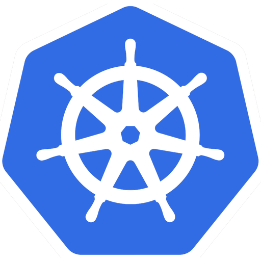

<p align="center">
  
</p>

<h1 align="center">K8s Admission Attack Lab</h1>

<p align="center"><strong>K8Admission</strong></p>

<p align="center">Apply 13 attack pods and one compliant pod to Kyverno, OPA Gatekeeper, and Pod Security Admission, and see which ones get through at deploy time</p>

The K8s Admission Attack Lab runs on a disposable `kind` cluster, on Kali or any host with Docker. It applies 13 attack pods and 1 compliant control pod to three admission engines, one engine at a time: Kyverno, OPA Gatekeeper, and built-in Pod Security Admission. For each pod it records whether Kubernetes accepted it (`ADMITTED`) or rejected it (`BLOCKED`). If an attack pod is admitted, the lab writes a Kyverno ValidatingPolicy, applies that policy, and applies the pod again. If the pod is now blocked, the gap is marked `[PROVED CLOSED]`. Results are written to `report/scorecard.html` and `report/phase2-matrix.txt`.

This lab only tests admission when a pod is created. Do not use it to compromise the host, and do not run peirates hostPath-cron. Run one engine at a time (about 4 GiB of RAM). Tokens and kubeconfigs stay on the lab host. Treat generated policies as lab drafts, not production rules.

## Key Features

- **13 attack pods and 1 compliant control, applied to each engine in turn.** The lab applies those 14 manifests with `kubectl` first to Kyverno, then to OPA Gatekeeper, then to built-in PSA. Each pod is recorded as `ADMITTED` or `BLOCKED` in `report/phase2-matrix.txt` and `report/scorecard.html`. Coverage is attack pods blocked out of 13. The compliant pod is not counted as an attack and must stay admitted.
- **Kyverno, OPA Gatekeeper, and built-in PSA, one at a time.** Kyverno is installed with the restricted Pod Security Standards policies in Enforce mode. It is then removed, and OPA Gatekeeper is installed with the gatekeeper-library PSP constraints. That is then removed, and built-in PSA is enabled with the namespace label `enforce=restricted`. Only one of these is active while its column is scored.
- **A generated Kyverno policy for each admitted attack.** For every attack pod that was `ADMITTED`, the lab writes a Kyverno ValidatingPolicy under `policies/suggested/`, applies it, and applies that pod again. If Kyverno now rejects the pod, the scorecard marks the gap `[PROVED CLOSED]`.
- **Kali-tool probes on the live cluster.** nmap scans API and node ports, nuclei runs Kubernetes templates, peirates in a test pod tries privileged and hostPath creates plus `get-pods` / `list-secrets`, and trivy scans the pod images. Output is written under `report/kali-tools/`. If a finding corresponds to a missing admission rule, the lab can write a Kyverno policy for it and re-apply the matching pod.
- **CLI or Grok Bot.** On Kali (or any Docker/kind host) you run `sudo ./run_all.sh`. Or you add the Grok Bot from [the public template](https://x.ai/bot/jOM5_aaw8G0b9kSWHoYDR) and ask it to run that script. Either path writes `report/scorecard.html`, `report/phase2-matrix.txt`, and `report/kali-tools/`.
- **Disposable `kind` cluster only.** The lab creates and uses cluster `admission-lab`. Do not point it at a production, shared, or third-party cluster.

## How It Works

<p align="center">
  
</p>

1. **You** start from Path A (the CLI) or Path B (the Grok Bot). Either path runs `./run_all.sh` on the lab host and writes `report/scorecard.html` and `report/phase2-matrix.txt`.

2. **Path A — CLI on Kali.** On a disposable Kali host, or any machine with Docker and kind, clone the repo and run `sudo ./run_all.sh`. The script apt-installs nmap, nuclei, peirates, and trivy if they are missing, creates the `kind` cluster if needed, then runs the engine tests and the Kali-tool stage.

3. **Path B — Grok Bot.** Open the [public bot template](https://x.ai/bot/jOM5_aaw8G0b9kSWHoYDR), add the bot, and start a chat. The bot asks whether you have a disposable lab you own, clones the repo if needed, and runs `sudo ./run_all.sh` on that host.

4. **kind cluster.** The lab uses a disposable cluster named `admission-lab`, created with kind on Docker (`kindest/node:v1.31.0` by default). Do not point the scripts at any other cluster.

5. **Admission engines.** 13 attack pods and 1 compliant control pod are applied to each engine in turn, with only one engine installed while its results are recorded.
   - **Kyverno** is a policy engine that runs as an admission webhook. In this lab it is loaded with the restricted Pod Security Standards policies in Enforce mode, so it rejects pods that break those rules (for example privileged containers, hostPath volumes, or running as root).
   - **OPA Gatekeeper** is also an admission webhook. It evaluates Rego ConstraintTemplates. This lab uses the gatekeeper-library PodSecurityPolicy templates, with constraints that deny privileged containers, hostPath volumes, host namespaces, and similar settings.
   - **Built-in Pod Security Admission (PSA)** is the API server's own controller. It is not a webhook and does not use custom rules. It is turned on with a namespace label `enforce=restricted`, and the API server itself rejects pods that fail the restricted standard.

   If the engine rejects the pod at admission time, the row is **BLOCKED** and the pod is not created. If Kubernetes accepts the pod, the row is **ADMITTED**. An ADMITTED attack pod is a gap. The compliant control pod must stay ADMITTED.

6. **Kali tools.** nmap, nuclei, peirates, and trivy then probe the live cluster. nmap scans the API and node ports, nuclei runs Kubernetes templates, peirates from a test pod tries privileged and hostPath creates plus `get-pods` and `list-secrets`, and trivy scans the images used by the pods. Output is written under `report/kali-tools/`. If a finding corresponds to a missing admission rule, the lab can write a Kyverno policy for it and re-apply that case.

7. **Generated policies and the scorecard.** For each ADMITTED attack pod, the lab writes a Kyverno ValidatingPolicy under `policies/suggested/` and applies it to the cluster. It then applies that attack pod again. If Kyverno now rejects it, the gap is marked `[PROVED CLOSED]`. If the compliant pod is also blocked, the new policy is too broad. Coverage, the per-engine matrix, and those proofs are written to `report/scorecard.html` and `report/phase2-matrix.txt`.

## Tech Stack

| Area | Technologies |
|------|----------------|
| Cluster | Docker, [kind](https://kind.sigs.k8s.io/), Kubernetes (`kindest/node:v1.31.0` by default) |
| Cluster tooling | kubectl, Helm |
| Admission engines | [Kyverno](https://kyverno.io/) ValidatingPolicy, [OPA Gatekeeper](https://open-policy-agent.github.io/gatekeeper/) PSP library, built-in Pod Security Admission (`enforce=restricted`) |
| Discovery | Kali Linux — nmap, nuclei, peirates, trivy |
| Interface | CLI (`./run_all.sh`) and [Grok Bot](https://x.ai/bot/jOM5_aaw8G0b9kSWHoYDR) |
| Reports | Scorecard HTML/JSON, text matrix, sanitized samples under `report/` |

## Setup

You can start from the CLI or from the Grok Bot; both run `./run_all.sh` on the lab host. Use a disposable host you own — Kali Rolling, or any machine with Docker — and about 4 GiB of RAM so one admission engine can run at a time. Do not point this at a production, shared, or third-party cluster.

### Prerequisites

On the lab host you need:

- Docker, kind, kubectl, and Helm
- Python 3 (for the stage scripts)
- About 4 GiB of RAM
- Internet access the first time, to pull images and engine charts

`./run_all.sh` will apt-install nmap, nuclei, peirates, and trivy if they are missing.

### Path A — CLI on Kali

```bash
git clone https://github.com/ritvikindupuri/K8Admission.git
cd K8Admission
sudo ./run_all.sh
```

`LAB` defaults to the repo root. `KUBECONFIG` defaults to `~/.kube/config`.

Reports land in:

- `report/scorecard.html`
- `report/phase2-matrix.txt`
- `report/kali-tools/`

To run a stage on its own after the repo is cloned:

```bash
./scripts/setup.sh                 # kind cluster + Kyverno PSS
python3 scripts/run_phase2.py      # engine tests + generated policies
python3 scripts/run_kali_stage.py  # nmap, nuclei, peirates, trivy, policy re-test
```

### Path B — Grok Bot

1. Open the public bot template and add the bot: [https://x.ai/bot/jOM5_aaw8G0b9kSWHoYDR](https://x.ai/bot/jOM5_aaw8G0b9kSWHoYDR).
2. Start a chat. The getting-started skill runs first and will ask, one at a time:
   - Whether you have a disposable lab you own and are authorized to use (a Kali host, or any machine with Docker and kind). The default is a local `kind` cluster named `admission-lab`.
   - Whether the repo is already cloned on that host.
3. If the repo is not on the host yet, clone it:

   ```bash
   git clone https://github.com/ritvikindupuri/K8Admission.git
   cd K8Admission
   ```

4. Ask the bot to run the lab (or run it yourself with `sudo ./run_all.sh`). The bot runs `sudo ./run_all.sh` on Kali: missing tools are installed if needed, the cluster is created if needed, then the engine tests and the Kali stage run.

The on-repo recipe is [`template/k8admission-template.json`](template/k8admission-template.json), with [`skills/k8admission-getting-started/SKILL.md`](skills/k8admission-getting-started/SKILL.md) and [`skills/k8admission-lab/SKILL.md`](skills/k8admission-lab/SKILL.md), if you ever need to rebuild the bot by hand.

## How to Use

### Run the full lab

From the repo root on the lab host:

```bash
sudo ./run_all.sh
```

This, in order:

1. Installs nmap, nuclei, peirates, and trivy if they are missing.
2. Creates `kind` cluster `admission-lab` if it does not exist (or exports kubeconfig if it does).
3. Runs the multi-engine battery and generates policies for whatever was admitted (`scripts/run_phase2.py`).
4. Runs the Kali-tool stage (`scripts/run_kali_stage.py`). If a finding maps to a missing admission rule, the lab can write a Kyverno policy for it and re-apply the matching pod.

### Run a single stage

Use these when you already have a cluster, or when you want to repeat one stage:

```bash
./scripts/setup.sh                 # kind + Kyverno PSS
python3 scripts/run_phase2.py      # engine tests + generated policies
python3 scripts/run_kali_stage.py  # nmap, nuclei, peirates, trivy, policy re-test
```

`LAB` defaults to the repo root. `KUBECONFIG` defaults to `~/.kube/config`.

### Read the scorecard and matrix

After a run, open:

| File | What it shows |
|------|----------------|
| `report/scorecard.html` | Coverage percentages, per-engine ADMITTED/BLOCKED results, and `[PROVED CLOSED]` lines, in a browser |
| `report/phase2-matrix.txt` | That matrix in plain text |
| `report/kali-tools/` | Raw and summarized nmap, nuclei, peirates, and trivy output |

How to read a result row:

- **`ADMITTED`** — the engine allowed the workload to deploy. That is a gap if the row is an attack scenario.
- **`BLOCKED`** — the engine rejected the pod at admission time, so it was not created.
- **`Kyverno + generated`** — after the lab wrote and applied policies for the gaps. Attack rows that were `ADMITTED` under a stock engine should be `BLOCKED` here.
- **`[PROVED CLOSED]`** — after the generated Kyverno policy was applied, that attack pod was applied again and was BLOCKED. A gap is not closed until this appears.
- **`compliant`** — the control workload. It must stay `ADMITTED` and Running after generated policies are applied. If it is blocked, a generated policy is too broad.

Coverage is attacks blocked divided by attack scenarios (13 in the battery). The compliant control is not counted as an attack.

### Generated policies

New Kyverno ValidatingPolicies are written under `policies/suggested/` and applied to the lab cluster. Read them before you reuse them. They are starting points from this lab, not production drop-ins.

### Rerun

To run the full lab again on that host:

```bash
cd K8Admission
sudo ./run_all.sh
```

Before scoring Kyverno, the scripts delete leftover policies under `policies/suggested/`, so a later run is not scored against policies from an earlier run. If the `kind` cluster already exists, `./run_all.sh` reuses it. To start from a clean cluster, delete it first and then rerun:

```bash
kind delete cluster --name admission-lab
sudo ./run_all.sh
```

### Grok Bot chat flow

1. Add the bot from [https://x.ai/bot/jOM5_aaw8G0b9kSWHoYDR](https://x.ai/bot/jOM5_aaw8G0b9kSWHoYDR) and start a conversation.
2. The bot introduces the lab and asks whether you have a disposable cluster you own. If you do not, it should stop. Do not ask it to target production or anyone else’s cluster.
3. If the repo is not on the lab host, clone `ritvikindupuri/K8Admission` as shown in Setup.
4. Ask it to run the lab. It should prefer `sudo ./run_all.sh` from the repo root, then point you at the scorecard and matrix.
5. You can also ask it to run a single stage, explain a matrix row, read a generated policy, or walk through a rerun. Tokens, kubeconfigs, and other secrets must stay off the chat transcript.
6. Guardrails the bot is expected to keep: admission-time testing only, no host compromise, no peirates hostPath-cron modules, one engine at a time.

### Where results live

- A written assessment of a disposable run, including coverage, proved-closed gaps, and peirates outcomes, is in [TEST_RESULTS.md](TEST_RESULTS.md).
- Sanitized artifacts from that work also live under [`report/samples/`](report/samples/).
- Live output from *your* run is under `report/` on the lab host, as listed above.

## License

MIT. See [LICENSE](LICENSE).

This lab is for disposable clusters you own. Do not run it against production, shared, or third-party clusters.
