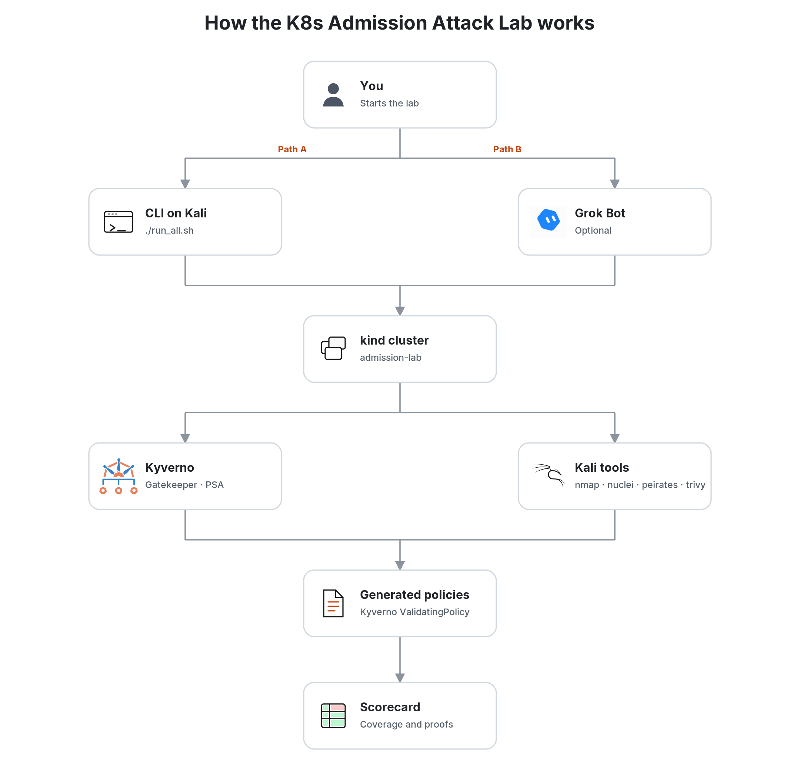

<h1 align="center">K8s Admission Attack Lab</h1>

<p align="center">A disposable lab that checks whether Kubernetes admission controllers block the attack at deploy time</p>

<p align="center">
  
  
  
  
  
</p>

## What it is

The K8s Admission Attack Lab is a Kali-driven admission-time test for Kubernetes. It fires the same 14-manifest battery at Kyverno, OPA Gatekeeper, and built-in Pod Security Admission, one engine at a time. Whatever the stock gate admits becomes a Kyverno ValidatingPolicy, and the same attack is re-run until the webhook blocks it.

This is a policy-gate test, not a runtime detect-and-remediate tool.

**Guardrails:** disposable `kind` lab only; admission-time testing only (no host compromise, no peirates hostPath-cron); one engine at a time (~4 GiB RAM); tokens and kubeconfigs stay on the lab host; generated policies are lab starting points, not production drop-ins.

## How the K8s Admission Attack Lab works

<p align="center">
  
</p>

1. **You** start from either path below. Both drive the same lab.
2. **Path A — CLI on Kali.** Clone the repo and run `sudo ./run_all.sh` on a disposable Kali host (or any machine with Docker and kind). The script installs missing Kali tools, stands up the cluster if needed, and drives the loop.
3. **Path B — Grok Bot (optional).** Ask the bot to drive the same lab on Kali. **TODO:** The public Bot template link will be added when it is published. Until then, use the CLI or build the bot by hand from the recipe in Setup.
4. Both paths run against the disposable **kind** cluster `admission-lab` (`kindest/node:v1.31.0` by default).
5. **Kyverno** (restricted PSS Enforce), Gatekeeper (PSP library), and built-in PSA `enforce=restricted` each see the same 14-manifest battery, one engine at a time. **Kali tools** — nmap, nuclei, peirates, and trivy — probe the live cluster.
6. Admitted attacks become **generated Kyverno ValidatingPolicies**. The same attack is re-run until the webhook blocks it. The **scorecard** records coverage, closed-loop proofs, and HTML/JSON under `report/`.

## Setup instructions

There are two ways in, and they run the same lab. **Path A** is the CLI on a disposable Kali (or Docker/kind) host. **Path B** is an optional Grok Bot that drives that same CLI on Kali.

### 1. Get the bot (optional)

**TODO:** The public Bot template link will be added when it is published. Until then, clone this repo and run the CLI (step 3).

Grok Bot shares a Bot template link, not a JSON import. The recipe is [`template/k8admission-template.json`](template/k8admission-template.json). To build the bot by hand:

1. Name it **K8s Admission Attack Lab** and paste the profile description from the JSON.
2. Add the four memories: lab-only admission testing, closed-loop workflow, honest Kali-tool reporting, lean usage.
3. Add [`skills/k8admission-lab/SKILL.md`](skills/k8admission-lab/SKILL.md) and [`skills/k8admission-getting-started/SKILL.md`](skills/k8admission-getting-started/SKILL.md). The getting-started skill runs first.
4. Leave routines and plugins empty.

### 2. Lab prerequisites

You need a disposable lab host you own — Kali Rolling, or any machine with Docker — and about 4 GiB of RAM so one admission engine can run at a time.

| Tool | Used for |
|------|----------|
| Docker, kind, kubectl, helm | `kind` cluster `admission-lab`, engine installs, apply / delete |
| nmap, nuclei, peirates, trivy | Kali discovery stage (`./run_all.sh` will apt-install these if they are missing) |

Do not point this at a production, shared, or third-party cluster.

### 3. Run the lab

```bash
git clone https://github.com/ritvikindupuri/K8Admission.git
cd K8Admission
sudo ./run_all.sh
```

Reports land in `report/scorecard.html`, `report/phase2-matrix.txt`, and `report/kali-tools/`. `LAB` defaults to the repo root; `KUBECONFIG` defaults to `~/.kube/config`.

To run a stage on its own:

```bash
./scripts/setup.sh                 # kind + Kyverno PSS
python3 scripts/run_phase2.py      # multi-engine battery + generated policies
python3 scripts/run_kali_stage.py  # nmap, nuclei, peirates, trivy, loop
```

In the matrix, attack rows that were `ADMITTED` under a stock engine should be `BLOCKED` under **Kyverno + generated**; the `compliant` control must stay admitted and Running; closed-loop lines should say `[PROVED CLOSED]`.

## Results

Lab scorecards and a write-up of a disposable run are in [TEST_RESULTS.md](TEST_RESULTS.md). Sanitized artifacts also live under [`report/samples/`](report/samples/).

## License

MIT. See [LICENSE](LICENSE).

This lab is for disposable clusters you own. Do not run it against production, shared, or third-party clusters.
