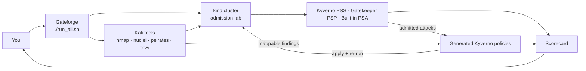

<p align="center">
  
</p>

<h1 align="center">Gateforge</h1>

<p align="center">Prove your Kubernetes admission gate actually blocks the attack</p>

<p align="center">
  
  
  
  
  
  
</p>

## Overview

Gateforge is a Kali-driven admission-time attack loop for Kubernetes. It fires the same crafted workload battery at Kyverno, OPA Gatekeeper, and built-in Pod Security Admission, one engine at a time, then turns whatever was admitted into a Kyverno ValidatingPolicy and re-runs the attack until the gate blocks it.

This is a policy-gate test, not a runtime detect-and-remediate tool. It measures the webhook that runs at deploy time.

**Guardrails**

- Disposable `kind` lab only. Do not point this at a production cluster.
- Admission-time testing only. No runtime host compromise, and no peirates hostPath-cron or node reverse-shell modules.
- One engine at a time, so the lab fits in about 4 GiB of RAM.
- Service-account tokens and kubeconfigs stay on the lab host. Published reports are redacted.
- Generated policies are starting points for a lab. Review them before you reuse them anywhere else.

## Key features

- **Same battery, three engines.** Fourteen manifests, including a compliant control, against Kyverno restricted PSS (Enforce), Gatekeeper PSP library constraints, and built-in PSA `enforce=restricted`.
- **Coverage matrix.** Each scenario is `BLOCKED` or `ADMITTED`. Coverage is attacks blocked over attack scenarios; the compliant pod must still be admitted and Running.
- **Closed loop.** Finding → generated Kyverno ValidatingPolicy → apply → re-run the same attack and prove `BLOCKED`.
- **Kali-tool discovery.** nmap on the kind control plane, nuclei Kubernetes templates, peirates from inside a test pod, and trivy on battery images. Mappable findings feed the same loop.
- **Found-by column.** The scorecard records whether a gap came from the manifest battery or a Kali tool.
- **One command.** `./run_all.sh` stands the lab up if needed, runs the multi-engine battery, then the Kali stage.
- **Shareable reports.** HTML scorecard, text matrix, JSON, and raw tool output under `report/`.

## System architecture

<p align="center">
  
</p>

```
You ── ./run_all.sh ── kind admission-lab ──┬── Kyverno PSS
                                            ├── Gatekeeper PSP
nmap / nuclei / peirates / trivy ───────────┴── Built-in PSA
         │                                       │
         │          admitted attacks = gaps      │
         └─────────► generate Kyverno policy ◄───┘
                             │
                             ▼
                      apply + re-run
                             │
                             ▼
                    BLOCKED [PROVED]  →  scorecard
```



1. **You** run the lab on a disposable host and read the scorecard.
2. **Gateforge** is `./run_all.sh`. It installs missing Kali tools, starts the cluster if needed, and drives the loop.
3. **kind cluster** `admission-lab` is a single-node Kubernetes lab (default image `kindest/node:v1.31.0`).
4. **Admission engines** see the same 14-manifest battery, one engine at a time, so results are comparable.
5. **Kali tools** probe the live cluster: nmap on 6443, 10250, 10255, 2379, and NodePorts; nuclei Kubernetes templates; peirates inside a test pod; trivy on the battery images.
6. **Generated policies** are Kyverno `ValidatingPolicy` YAML for whatever stock PSS, Gatekeeper, or PSA admitted. Mappable Kali findings can enter the same generator.
7. **Scorecard** is the side-by-side matrix, coverage percentages, closed-loop proofs, and HTML/JSON under `report/`.

## Tech stack

| Component | Role |
|-----------|------|
| Kali Linux | Host for nmap, nuclei, peirates, and trivy, plus the `kind` node. |
| kind | Disposable single-node Kubernetes cluster `admission-lab`. |
| kubectl / helm | Apply manifests, install engines, collect deny messages. |
| Kyverno | Restricted Pod Security Standards in Enforce, then generated ValidatingPolicies for gaps. |
| OPA Gatekeeper | gatekeeper-library Pod Security Policy templates and constraints. Audit off when possible; no mutation. |
| Built-in PSA | Namespace labels `pod-security.kubernetes.io/enforce=restricted`. |
| nmap | Control-plane and NodePort discovery on the kind node. |
| nuclei | Kubernetes templates against the live API and, with `-code`, cluster objects. |
| peirates | In-pod service-account abuse: list pods, list secrets, try to create a privileged or hostPath pod. |
| trivy | Image vulnerability scan of the battery images. |
| MITRE ATT&CK for Containers | Mapping for each scenario and Kali-tool attempt. |

## Setup instructions

You need a lab host with Docker, enough RAM to run one admission engine at a time (about 4 GiB), and network access to pull images and Helm charts. Kali Rolling is the path this repo was built on.

### 1. Clone

```bash
git clone https://github.com/ritvikindupuri/Gateforge.git
cd Gateforge
```

### 2. Tools

On Kali, `./run_all.sh` will `apt-get install` nmap, nuclei, peirates, and trivy if they are missing. You still need Docker, kind, kubectl, and helm on `PATH`.

| Tool | Used for |
|------|----------|
| Docker | kind node runtime |
| kind | Cluster `admission-lab` |
| kubectl | Apply / delete / describe |
| helm | Kyverno and Gatekeeper installs |
| nmap, nuclei, peirates, trivy | Kali discovery stage |

### 3. One-command run

```bash
sudo ./run_all.sh
```

Reports land in `report/scorecard.html`, `report/phase2-matrix.txt`, and `report/kali-tools/`.

### Optional: run a stage on its own

```bash
export PATH="/usr/local/bin:$PATH"
./scripts/setup.sh                          # kind + Kyverno PSS only
python3 scripts/run_scorecard.py            # original 8-manifest Kyverno pass
python3 scripts/run_phase2.py               # multi-engine battery + generated policies
python3 scripts/run_kali_stage.py           # nmap, nuclei, peirates, trivy, loop
```

`LAB` defaults to the repo root. `KUBECONFIG` defaults to `~/.kube/config`. Override either if your lab layout is different.

| Path | What it is |
|------|------------|
| `run_all.sh` | One-command entrypoint. |
| `scripts/setup.sh` | kind cluster and Kyverno PSS (Enforce). |
| `scripts/run_phase2.py` | Multi-engine battery, policy generation, HTML matrix. |
| `scripts/run_kali_stage.py` | Kali tools and closed-loop proofs. |
| `scripts/run_scorecard.py` | Phase 1 Kyverno-only scorecard. |
| `manifests/` | Attack battery, `08-compliant.yaml` as the control. |
| `cluster/` | kind config, Helm values, peirates probe / payload pods. |
| `policies/suggested/` | Generated ValidatingPolicies from the lab run. |
| `report/samples/` | Sanitized scorecard and tool output from 2026-11-20. |
| `assets/icon.svg`, `assets/architecture.svg` | Mark and architecture figure. |

## Usage guide

### 1. Stand up the lab

`./run_all.sh` creates `kind` cluster `admission-lab` if it is not already there, then runs phase 2 and the Kali stage. Use a disposable host. The kubeconfig it writes is local and is not part of this repo.

### 2. Read the matrix

Open `report/scorecard.html` or `report/phase2-matrix.txt`. Check three things:

- Attack rows should move from `ADMITTED` under a stock engine to `BLOCKED` under **Kyverno + generated**.
- The `compliant` control must stay `ADMITTED` and Running after the generated policies are applied.
- Closed-loop lines should say `[PROVED CLOSED]` for each gap the generator claimed to fix.

### 3. Read the Kali stage

`report/kali-stage.txt` and `report/kali-tools/` show raw tool output.

- nmap findings on etcd (2379) or kubelet (10250) are infrastructure exposure on the kind node. They are recorded. They are not turned into Pod admission policies.
- nuclei Kubernetes `-code` hits are often stock kube-system objects (CoreDNS imagePullPolicy, built-in ClusterRoles). Those are recorded. Gateforge does not auto-enforce policies that would break the control plane.
- peirates `get-pods` and `list-secrets` exercise RBAC of the probe service account, not the admission webhook. Privileged and hostPath *creates* are the admission tests.
- This repo's peirates package has no working one-shot kubectl menu (`-c` is not accepted; the interactive kubectl action errored). Privileged and hostPath creates are issued with in-pod `kubectl` as `kali-probe-sa`, the same service account peirates loads from the pod token. That is an honest substitute, not the peirates TUI itself.
- trivy results are whatever the scanner returned for that run. A zero CVE count is not a claim that the image is clean.

### 4. Inspect a generated policy

Policies land in `policies/suggested/`. They are Kyverno `ValidatingPolicy` resources (CEL), not legacy `ClusterPolicy`. Read the match and the expression before you apply them anywhere except this lab. One registry expression originally treated the dot in `busybox:1.36` as a registry host; the checked-in policy allows short names and only flags a dotted first path segment.

## Sample output

From a disposable lab run on 2026-11-20 (America/Indianapolis). Your numbers will move with engine versions and policy packs.

```
SCENARIO            Kyverno PSS    Gatekeeper PSP   Built-in PSA  Kyverno + generated
-------------------------------------------------------------------------------------
privileged            BLOCKED         BLOCKED         BLOCKED         BLOCKED
hostpath              BLOCKED         BLOCKED         BLOCKED         BLOCKED
hostnetwork           BLOCKED         BLOCKED         BLOCKED         BLOCKED
run-as-root           BLOCKED         BLOCKED         BLOCKED         BLOCKED
docker-sock           BLOCKED         BLOCKED         BLOCKED         BLOCKED
latest-tag            ADMITTED        ADMITTED        ADMITTED        BLOCKED
no-limits             ADMITTED        ADMITTED        ADMITTED        BLOCKED
compliant             ADMITTED        ADMITTED        ADMITTED        ADMITTED      (control)
hostpid               BLOCKED         BLOCKED         BLOCKED         BLOCKED
hostipc               BLOCKED         BLOCKED         BLOCKED         BLOCKED
cap-sys-admin         BLOCKED         BLOCKED         BLOCKED         BLOCKED
cap-net-raw           BLOCKED         BLOCKED         BLOCKED         BLOCKED
untrusted-registry    ADMITTED        ADMITTED        ADMITTED        BLOCKED
writable-rootfs       ADMITTED        BLOCKED         ADMITTED        BLOCKED

Coverage = attacks blocked / attack scenarios (control excluded).
  Kyverno PSS:         69.2%  (9/13)   gaps: latest-tag, no-limits, untrusted-registry, writable-rootfs
  Gatekeeper PSP:      76.9%  (10/13)  gaps: latest-tag, no-limits, untrusted-registry
  Built-in PSA:        69.2%  (9/13)   gaps: latest-tag, no-limits, untrusted-registry, writable-rootfs
  Kyverno + generated: 100.0% (13/13)  gaps: none   compliant still ADMITTED; Running

Closed loop (finding → generated Kyverno policy → re-run):
  latest-tag          ADMITTED → deny-latest-tag            → BLOCKED  [PROVED CLOSED]
  no-limits           ADMITTED → require-resource-limits    → BLOCKED  [PROVED CLOSED]
  untrusted-registry  ADMITTED → restrict-image-registries  → BLOCKED  [PROVED CLOSED]
  writable-rootfs     ADMITTED → require-readonly-rootfs    → BLOCKED  [PROVED CLOSED]
```

Kali-tool stage from the same lab (20:00 EST, America/Indianapolis):

- nmap: 6443, 10250, and 2379 open on the kind node; 10255 closed; no NodePorts; anonymous API 403.
- nuclei: 33 matches / 20 unique Kubernetes `-code` templates, mostly kube-system; anonymous HTTP scan had no hits.
- trivy: `busybox:1.36` and `busybox:latest` reported 0 critical / high / medium in that run.
- peirates: list pods and list secrets (canary secret only) ALLOWED by RBAC. Privileged and hostPath creates ALLOWED with no admission engine; STOPPED by admission under Kyverno, Gatekeeper, PSA, and Kyverno + generated.

Full sanitized artifacts are in [`report/samples/`](report/samples/).

## What already exists

Gateforge is not a generic cluster scanner, and it is not a runtime defender.

| Tool | What it does | Where Gateforge differs |
|------|----------------|-------------------------|
| kube-hunter, peirates | Find or abuse cluster issues, then stop at the finding. | Findings are re-fired at live admission webhooks, then closed with a generated policy and a re-proof. |
| Kubescape, Polaris | Scan posture and configuration. | Gateforge applies workloads and records whether the webhook admitted them. |
| Kyverno Chainsaw | Tests policies you already wrote. | Gateforge tests engines you have not fully covered, then writes the missing policy. |
| Policy Reporter | Visualizes policy results. | Gateforge produces the matrix and the proof, not only a view. |
| IronClaw `--emit-policy`, Valqore `generate_policy` | Emit YAML from static scans. | Closest cousins. They do not run the same live battery against Kyverno, Gatekeeper, and PSA, then re-apply the admitted attack to the live webhook. |
| K8sGPT policy drafts | Assistant-style dry-run YAML. | No multi-engine live re-proof in this workflow. |

KARMA, a related project by the same author, is a runtime Kubernetes attack / detect / remediate loop. Gateforge is the deploy-time gate: it asks whether the admission controller would have blocked the workload before it ran.

## MITRE ATT&CK for Containers

| Scenario or attempt | Technique | ID |
|---------------------|-----------|----|
| privileged, cap-sys-admin, hostpath, hostpid | Escape to Host | [T1611](https://attack.mitre.org/techniques/T1611/) |
| docker-sock | Container Administration Command | [T1609](https://attack.mitre.org/techniques/T1609/) |
| run-as-root, cap-sys-admin | Abuse Elevation Control Mechanism | [T1548](https://attack.mitre.org/techniques/T1548/) |
| hostnetwork, cap-net-raw | Network Boundary Bridging / Network Sniffing | [T1599](https://attack.mitre.org/techniques/T1599/), [T1040](https://attack.mitre.org/techniques/T1040/) |
| hostipc | Unsecured Credentials (shared IPC) | [T1552](https://attack.mitre.org/techniques/T1552/) |
| latest-tag, untrusted-registry | Supply Chain Compromise / Implant Internal Image | [T1195](https://attack.mitre.org/techniques/T1195/), [T1525](https://attack.mitre.org/techniques/T1525/) |
| no-limits | Resource Hijacking | [T1496](https://attack.mitre.org/techniques/T1496/) |
| writable-rootfs | File and Directory Permissions Modification | [T1222](https://attack.mitre.org/techniques/T1222/) |
| peirates list-pods | Container and Resource Discovery | [T1613](https://attack.mitre.org/techniques/T1613/) |
| peirates list-secrets | Unsecured Credentials / Valid Accounts | [T1552](https://attack.mitre.org/techniques/T1552/), [T1078](https://attack.mitre.org/techniques/T1078/) |
| peirates create privileged / hostPath pod | Deploy Container + Escape to Host | [T1610](https://attack.mitre.org/techniques/T1610/), [T1611](https://attack.mitre.org/techniques/T1611/) |

Applying a workload through admission is itself [T1610 Deploy Container](https://attack.mitre.org/techniques/T1610/). The table lists the technique each scenario is meant to exercise if the gate admits it.

## Disclaimer

Gateforge is an authorized lab tool for disposable clusters you own. Use it only where you have permission. It is not a product assessment of Kyverno, Gatekeeper, or Kubernetes, and a 100% lab score is not a claim that a production cluster is safe.

Do not run this against production, shared, or third-party clusters. Do not use it to attack systems you do not own. The attack manifests, peirates probes, and generated policies exist to test admission webhooks, not to compromise hosts. The author and contributors are not responsible for misuse.

## License

MIT. See [LICENSE](LICENSE).
