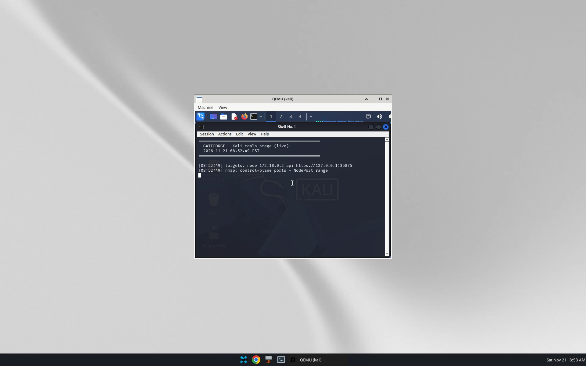
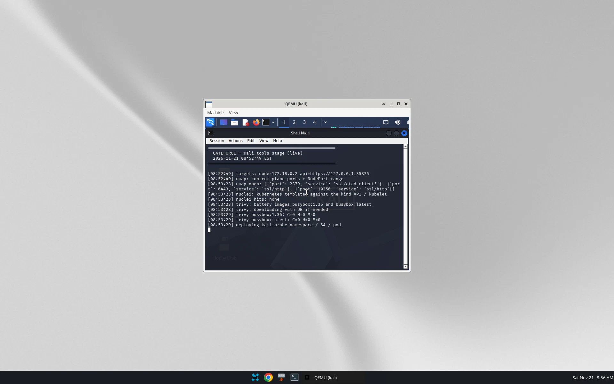
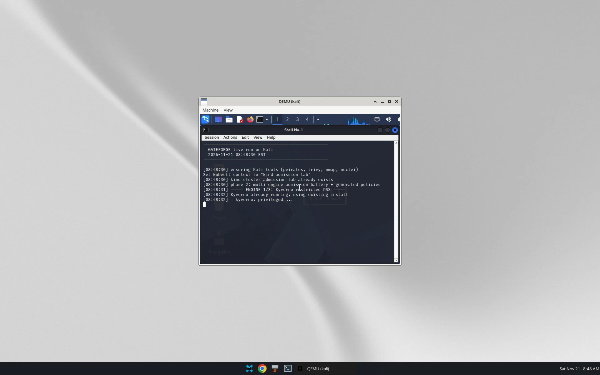
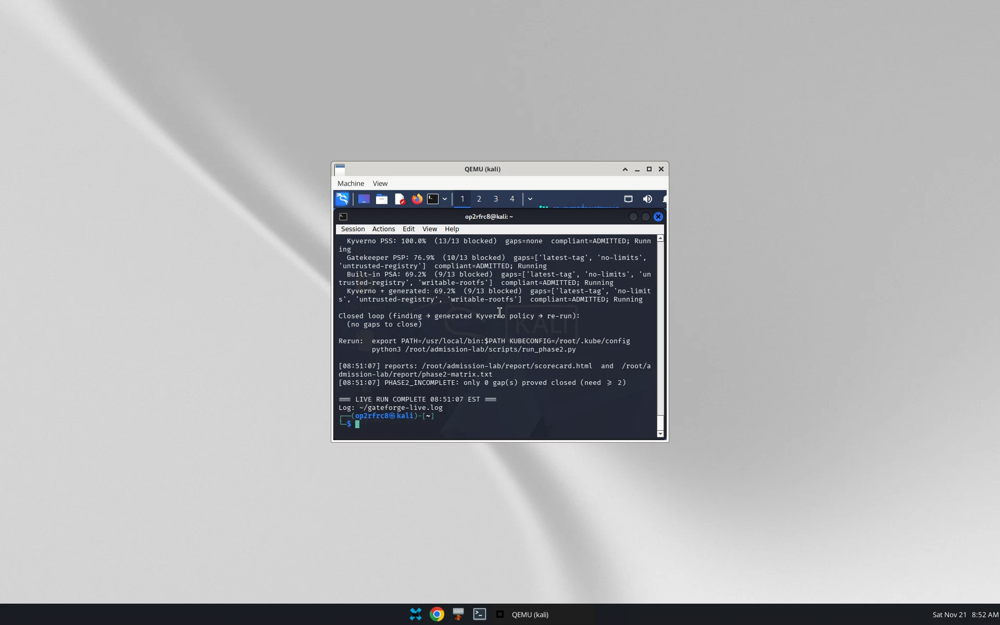
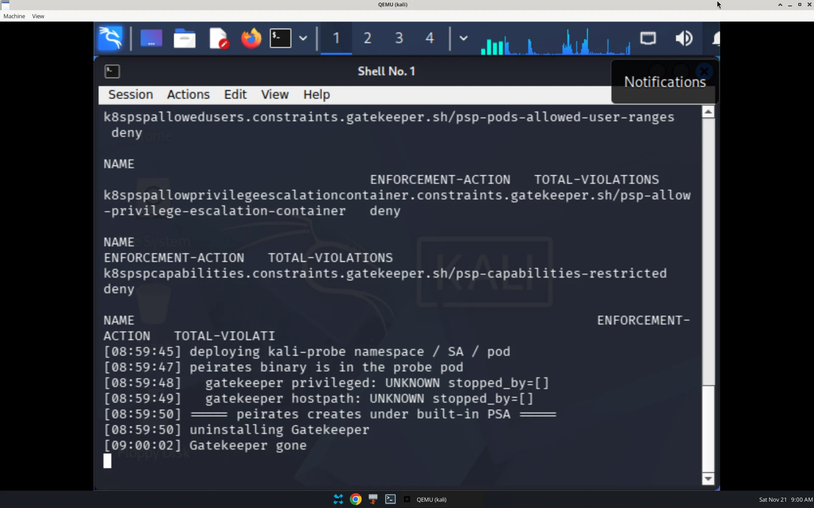
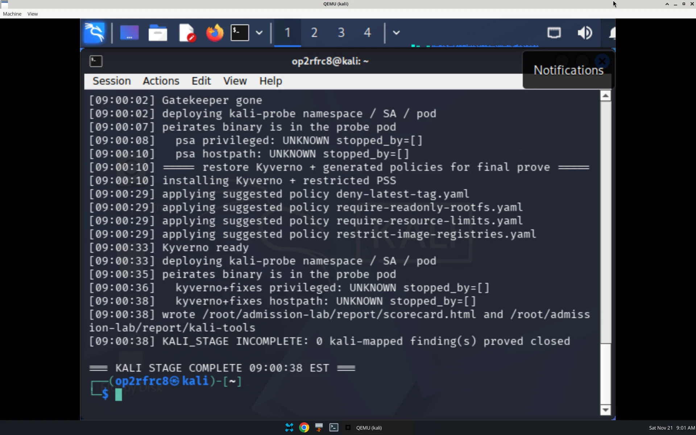

# K8s Admission Attack Lab

## Security Assessment Report

| | |
|---|---|
| **Project** | K8s Admission Attack Lab |
| **Date** | 21 November 2026 (America/Indianapolis, EST) |
| **Tester** | Ritvik Indupuri |
| **Environment** | Disposable Kali Linux VM; `kind` cluster `admission-lab`; Kubernetes v1.31.0 (`kindest/node:v1.31.0`); one admission engine at a time (~4 GiB RAM) |
| **Version** | [ritvikindupuri/K8Admission](https://github.com/ritvikindupuri/K8Admission) (scripts and policies in this repository) |
| **Classification** | Lab assessment only — not a production cluster, and not a vendor product evaluation |

## Executive Summary

This assessment tested whether stock Kubernetes admission controls on a disposable `kind` cluster would block a fixed battery of 13 attack workloads (plus one compliant control) at deploy time. The same battery was fired at Kyverno restricted Pod Security Standards (Enforce), OPA Gatekeeper with the gatekeeper-library PSP constraints, and built-in Pod Security Admission (`enforce=restricted`). Gaps that a stock engine admitted were turned into Kyverno `ValidatingPolicy` resources and re-run against the live webhook.

A first live run on the morning of 21 November 2026 (starting 08:48 EST) could not be used as the scoring source of truth. Leftover generated policies from a prior loop were still installed, so stock Kyverno appeared to block 13/13 attacks and the closed loop reported `PHASE2_INCOMPLETE` with no gaps to close. The Kali-tools stage also classified every peirates privileged and hostPath create as `UNKNOWN`, after an earlier stale `kali-probe` pod had timed out. Those lab-harness defects were fixed, and a clean rerun was completed the same morning (phase 2 finished 09:09 EST; Kali stage finished 09:22 EST).

On the clean rerun, stock Kyverno and built-in PSA each blocked 9 of 13 attacks (69.2%). Gatekeeper blocked 10 of 13 (76.9%), including writable root filesystems. The four gaps — `:latest` tags, missing resource limits, untrusted image registries, and a writable container root filesystem — were closed with generated Kyverno policies and independently re-proved `BLOCKED`. The Kyverno + generated column reached **13/13** blocked, and the compliant control stayed admitted and Running. Peirates privileged and hostPath creates, issued from inside a test pod as `kali-probe-sa`, were `ALLOWED` with no admission engine and `STOPPED` by admission under Kyverno, Gatekeeper, PSA, and Kyverno + generated.

This is not a claim that a production cluster is safe. The lab is a disposable single-node `kind` cluster, and generated policies are starting points for that lab.

## Scope and Rules of Engagement

**In scope**

- The disposable `kind` cluster `admission-lab` on a Kali lab host the tester owns.
- Admission-time validation only: whether a webhook or built-in PSA admits or denies a Pod at create time.
- The 14-manifest battery under `manifests/`, including the compliant control `08-compliant.yaml`.
- Kali-tool discovery against that cluster: nmap on 6443, 10250, 10255, 2379, and NodePorts; nuclei Kubernetes templates; peirates from the `kali-probe` pod; trivy on the battery images.
- Auto-generated Kyverno policies under `policies/suggested/` and a re-proof on the live webhook.

**Out of scope**

- Production, shared, or third-party clusters.
- Runtime host compromise, node breakout, or persistence on the lab VM.
- peirates `attack-pod-hostpath-mount` (it writes a persistent reverse-shell cron line on the node) and any similar host-modifying module.
- Publishing service-account tokens, kubeconfigs, or other secrets.

The tester ran the CLI path (`sudo ./run_all.sh`) on the Kali VM. An optional Grok Bot path can drive the same lab; it was not required for this assessment.

## Methodology

1. Stand or reuse `kind` cluster `admission-lab`.
2. Purge leftover generated/suggested ValidatingPolicies so the stock Kyverno pass is not contaminated by a prior loop.
3. Fire the same 14-manifest battery at each engine, one at a time.
4. Record `BLOCKED` or `ADMITTED`, plus the admitting or denying policy names when the API returns them.
5. For every attack Kyverno admitted, generate a Kyverno `ValidatingPolicy`, apply it, and re-run that attack.
6. Re-run the full battery under Kyverno + generated policies. The compliant control must stay admitted and Running.
7. Run nmap, nuclei, and trivy, then peirates from `kali-probe` (list pods, list secrets, create a privileged pod, create a hostPath pod) with no admission engine and again under each engine.

Coverage is attacks blocked divided by the 13 attack scenarios (the compliant row is excluded). A gap is marked **PROVED CLOSED** only when the re-run is `BLOCKED`.

## Environment

| Item | Value |
|------|--------|
| Lab host | Kali Linux VM (tester-owned, disposable) |
| Cluster | `kind` / `admission-lab`, Kubernetes v1.31.0 |
| Node | Single worker, Docker-backed, ~4 GiB RAM |
| Stock engines | Kyverno restricted PSS (Enforce); OPA Gatekeeper PSP library (deny, no mutation); built-in PSA `enforce=restricted` |
| Probe | Namespace `kali-probe`, service account `kali-probe-sa`, canary secret only |
| Time zone | America/Indianapolis (EST on this date) |
| First live run | 08:48:30–09:00:38 EST, 21 November 2026 (contaminated / incomplete) |
| Clean rerun | `run_all.sh` started 09:06:40 EST; phase 2 09:09:09 EST; Kali stage 09:22:58 EST |

## Findings

| ID | Severity | Title | Status |
|----|----------|-------|--------|
| F-01 | High | Stock admission engines admit `:latest` image tags | Proved closed |
| F-02 | Medium | Stock admission engines admit pods with no resource limits | Proved closed |
| F-03 | High | Stock admission engines admit images from an untrusted registry | Proved closed |
| F-04 | Medium | Kyverno PSS and built-in PSA admit a writable container root filesystem | Proved closed |
| F-05 | Medium | kind node exposes etcd (2379) and kubelet (10250) on the lab network | Informational (recorded, not a Pod-admission policy) |
| F-06 | Low | Probe service account can list pods and secrets in `kali-probe` | Informational (intended RBAC of the probe role) |
| L-01 | High | State leak: leftover generated policies inflated stock Kyverno to 100% | Fixed |
| L-02 | High | Peirates privileged/hostPath creates were classified `UNKNOWN` | Fixed |
| L-03 | Medium | Stale `kali-probe` pod caused a Ready-condition timeout after VM reboot | Fixed |

Severities describe impact **on this lab cluster if the gate admits the workload**, not a production estate. L-01–L-03 are defects in the assessment harness, not cluster vulnerabilities; they are included because they changed the first run's results.

### F-01 — Stock admission engines admit `:latest` image tags

**Description.** Manifest `06-latest-tag.yaml` uses a floating `busybox:latest` tag. On the clean rerun, Kyverno PSS, Gatekeeper, and built-in PSA all admitted the pod. A floating tag lets the image that actually runs change without a new review of the manifest.

**Evidence.** Clean-rerun matrix, 09:09:09 EST (America/Indianapolis): `latest-tag` is `ADMITTED` under all three stock engines and `BLOCKED` under Kyverno + generated. The first live run's matrix cannot be used for the stock Kyverno column; see L-01 and Figure 2.

**Impact.** An unexpected or malicious image can be scheduled without changing the workload YAML, which weakens supply-chain review (MITRE [T1195](https://attack.mitre.org/techniques/T1195/) Supply Chain Compromise).

**Remediation.** Generated Kyverno ValidatingPolicy `deny-latest-tag` (`policies/suggested/deny-latest-tag.yaml`).

**Verification.** Re-run at 09:08:49 EST: `BLOCKED` by `deny-latest-tag`. Marked `[PROVED CLOSED]`. The compliant pod, which does not use `:latest`, stayed admitted.

### F-02 — Stock admission engines admit pods with no resource limits

**Description.** Manifest `07-no-limits.yaml` omits CPU and memory limits. All three stock engines admitted it on the clean rerun.

**Evidence.** Clean-rerun matrix: `no-limits` is `ADMITTED` under Kyverno PSS, Gatekeeper, and PSA, and `BLOCKED` under Kyverno + generated.

**Impact.** A workload can consume unbounded CPU or memory on the node ([T1496](https://attack.mitre.org/techniques/T1496/) Resource Hijacking). On this single-node lab that is a denial-of-service against the control plane and other pods, not a cluster-wide production impact.

**Remediation.** Generated policy `require-resource-limits`.

**Verification.** Re-run at 09:08:54 EST: `BLOCKED` by `require-resource-limits`. `[PROVED CLOSED]`. The compliant pod, which sets limits, stayed admitted.

### F-03 — Stock admission engines admit images from an untrusted registry

**Description.** Manifest `13-untrusted-registry.yaml` pulls from a registry host that is not on an allow list. All three stock engines admitted it on the clean rerun.

**Evidence.** Clean-rerun matrix: `untrusted-registry` is `ADMITTED` under all three stock engines and `BLOCKED` under Kyverno + generated.

**Impact.** A workload can run an image from a registry the operator did not intend to trust ([T1525](https://attack.mitre.org/techniques/T1525/) Implant Internal Image, [T1195](https://attack.mitre.org/techniques/T1195/)).

**Remediation.** Generated policy `restrict-image-registries`. The expression allows short names such as `busybox:1.36` and only treats a dotted first path segment as a registry host (an earlier draft incorrectly treated the dot in tag `1.36` as a registry).

**Verification.** Re-run at 09:08:58 EST: `BLOCKED` by `restrict-image-registries`. `[PROVED CLOSED]`. The compliant `busybox:1.36` pod stayed admitted.

### F-04 — Kyverno PSS and built-in PSA admit a writable container root filesystem

**Description.** Manifest `14-writable-rootfs.yaml` leaves the container root filesystem writable. On the clean rerun, Kyverno restricted PSS and built-in PSA admitted it. Gatekeeper blocked it.

**Evidence.** Clean-rerun matrix: `writable-rootfs` is `ADMITTED` under Kyverno PSS and PSA, `BLOCKED` under Gatekeeper PSP, and `BLOCKED` under Kyverno + generated.

**Impact.** A compromised process can write to the container filesystem more easily ([T1222](https://attack.mitre.org/techniques/T1222/) File and Directory Permissions Modification). This is not, by itself, a node escape.

**Remediation.** Generated policy `require-readonly-rootfs`.

**Verification.** Re-run at 09:09:02 EST: `BLOCKED` by `require-readonly-rootfs`. `[PROVED CLOSED]`.

### F-05 — kind node exposes etcd (2379) and kubelet (10250) on the lab network

**Description.** nmap against the kind node (InternalIP `172.18.0.2`) found 6443, 10250, and 2379 open, 10255 closed, and no NodePorts. That is typical of a kind control plane on the Docker bridge, but etcd and the kubelet API are still exposed to that network.

**Evidence.** Figure 3 shows the Kali-tools stage starting nmap at 08:52:49 EST. Figure 4 shows the open-port list from the first live run: 2379 (`ssl/etcd-client?`), 6443, and 10250. The clean rerun at 09:22:58 EST reported the same three open ports. A prior documented pass also saw anonymous API requests return 403.

<p align="center">
  
</p>

<p align="center"><em>Figure 3: First live run, 08:52 EST (America/Indianapolis) — nmap is starting against the kind node at 172.18.0.2 and the published API at 127.0.0.1:35875.</em></p>

<p align="center">
  
</p>

<p align="center"><em>Figure 4: First live run, 08:53 EST — nmap reports 2379, 6443, and 10250 open; nuclei reports no hits in this pass; trivy reports 0 critical / high / medium on busybox:1.36 and busybox:latest. The stage then starts deploying kali-probe, which later timed out (see L-03).</em></p>

**Impact.** Anyone who can reach the Docker/kind network may attempt etcd or kubelet access ([T1613](https://attack.mitre.org/techniques/T1613/) Container and Resource Discovery, [T1552](https://attack.mitre.org/techniques/T1552/) Unsecured Credentials). This is an infrastructure finding, not a Pod admission gap. The lab does not turn it into a ValidatingPolicy, because a Pod policy would not close etcd or kubelet exposure.

**Remediation.** None generated. Keep this cluster off untrusted networks; do not treat kind's published ports as a production control plane.

**Verification.** Recorded on both the first live run and the clean rerun. Not proved closed — out of scope for Pod admission policies.

### F-06 — Probe service account can list pods and secrets in `kali-probe`

**Description.** The probe Role grants `get`/`list` on pods and secrets in `kali-probe` so peirates can be exercised. On the clean rerun, peirates `get-pods` and `list-secrets` (canary secret only) were `ALLOWED`. That is RBAC, not the admission webhook.

**Impact.** Low in this lab: the secret is a canary (`lab-canary-only, not a real credential`). The same pattern in a real namespace would be credential and inventory exposure ([T1613](https://attack.mitre.org/techniques/T1613/), [T1552](https://attack.mitre.org/techniques/T1552/), [T1078](https://attack.mitre.org/techniques/T1078/)).

**Remediation.** None generated. The Role is intentional for the probe.

**Verification.** Clean rerun, 09:12:38–09:12:39 EST: both calls `ALLOWED stopped_by=[]`.

## What the first live run exposed and how it was fixed

The first CLI run started at 08:48:30 EST, America/Indianapolis. It is documented here because its scorecard was wrong, and because the screenshots below are from that run.

### L-01 — State leak: leftover generated policies inflated stock Kyverno to 100%

**Description.** `run_phase2.py` reused the already-running Kyverno install (`Kyverno already running; using existing install`) and did not delete ValidatingPolicies generated by the previous closed loop. Stock Kyverno therefore enforced `deny-latest-tag`, `require-resource-limits`, `restrict-image-registries`, and `require-readonly-rootfs` during the “stock PSS” pass. The engine reported 13/13 blocked, `Kyverno stock gaps: []`, and `PHASE2_INCOMPLETE: only 0 gap(s) proved closed`. After Kyverno was uninstalled and reinstalled for the “Kyverno + generated” column, those four policies were no longer present, so the same attacks were `ADMITTED` and that column scored only 69.2% — the opposite of a closed loop.

**Evidence.**

<p align="center">
  
</p>

<p align="center"><em>Figure 1: First live run, 08:48 EST — the CLI run is starting the Kyverno battery on the existing kind cluster.</em></p>

<p align="center">
  
</p>

<p align="center"><em>Figure 2: Phase 2 matrix from the first live run (08:51 EST). Stock Kyverno is shown as 100% (13/13) because leftover generated policies were still installed; the closed loop has no gaps to close. Gatekeeper (76.9%) and built-in PSA (69.2%) already showed the real gaps. The Kyverno + generated column is 69.2% because a fresh Kyverno install no longer had those leftover policies.</em></p>

**Impact.** A false clean bill of health for stock Kyverno, and no generated proofs, if an operator trusted that matrix.

**Remediation.** `run_phase2.py` now deletes every ValidatingPolicy that is not in the stock restricted PSS set (including policies labeled `lab.component=suggested-policy` and names under `policies/suggested/`) before the stock Kyverno battery, and again when an existing Kyverno install is kept.

**Verification.** Clean rerun at 09:06:40 EST logged `deleted leftover policies: ['deny-latest-tag', 'require-readonly-rootfs', 'require-resource-limits', 'restrict-image-registries']`. Stock Kyverno then admitted the four real gaps and scored 69.2% (9/13). The loop generated and proved all four policies. `PHASE2_OK: 4 gaps proved closed` at 09:09:09 EST.

### L-02 — Peirates privileged/hostPath creates were classified `UNKNOWN`

**Description.** Creates were sent to peirates 1.1.28's interactive kubectl menu as stdin (`kubectl apply -f ...`). The TUI printed `Command unrecognized` and `Error running command` and never applied the manifest, so `classify_attempt` returned `UNKNOWN stopped_by=[]` for every engine.

**Evidence.**

<p align="center">
  
</p>

<p align="center"><em>Figure 5: First live run, 08:59 EST — Gatekeeper constraints are installed; peirates privileged and hostPath creates under Gatekeeper are classified UNKNOWN. The stage then switches to built-in PSA.</em></p>

<p align="center">
  
</p>

<p align="center"><em>Figure 6: End of the first Kali-tools stage, 09:00 EST, before the create-path fix — peirates privileged and hostPath results are UNKNOWN under the engines, and the stage finishes incomplete.</em></p>

**Impact.** The assessment could not say whether admission stopped a privileged or hostPath create from a compromised pod service account.

**Remediation.** Creates now use in-pod `/tools/kubectl` as `kali-probe-sa` (the same service-account token peirates loads). The classifier reads that kubectl output (`... created` vs admission webhook / `violates PodSecurity` / Gatekeeper deny) and ignores the broken TUI. The peirates kubectl menu is still not used.

**Verification.** Clean Kali stage (09:12–09:22 EST):

| Pass / engine | privileged create | hostPath create |
|---------------|-------------------|-----------------|
| No admission engine | ALLOWED | ALLOWED |
| Kyverno PSS | STOPPED (admission) | STOPPED (admission) |
| Gatekeeper PSP | STOPPED (admission) | STOPPED (admission) |
| Built-in PSA | STOPPED (admission) | STOPPED (admission) |
| Kyverno + generated | STOPPED (admission) | STOPPED (admission) |

Raw output for an allowed create is `pod/peirates-priv-attempt created`. A Kyverno deny is `admission webhook "vpol.validate.kyverno.svc-fail" denied the request`. A PSA deny is `forbidden: violates PodSecurity "restricted:latest"`. A Gatekeeper deny names a `ValidatingAdmissionPolicy`. `KALI_STAGE OK: 2 kali-mapped finding(s) proved closed` at 09:22:58 EST.

### L-03 — Stale `kali-probe` pod caused a Ready-condition timeout

**Description.** After a VM reboot, a leftover `kali-probe` pod (Unknown, hours old) was left in place. `kubectl apply` was treated as idempotent, and `kubectl wait --for=condition=Ready` timed out around 08:53–08:56 EST (visible in Figure 4 as the stage moving into probe deploy). A later retry in the same first run got a Ready pod, but the create-path bug in L-02 still produced UNKNOWN results. A related apply failure appeared at 09:09:09 EST on the clean `run_all.sh` when the probe pod spec changed (`restartPolicy` / `sleep` were immutable on the existing pod). That is the same class of defect: the setup must delete and recreate the pod instead of applying over a leftover one.

**Impact.** The Kali stage can fail or be delayed; a first-time operator may think the cluster is unhealthy.

**Remediation.** `setup_probe_pod()` now removes a leftover `kali-probe` pod (Unknown, Failed, Succeeded, or not Ready) and retries the wait once. Immutable-field applies are handled by deleting the pod and re-applying. `restartPolicy` is `Always` and the container sleeps indefinitely so the probe does not exit after one hour.

**Verification.** The clean Kali stage at 09:11:10 EST recreated the probe and completed. Peirates creates in L-02 ran to completion after that.

## Engine Coverage Results

Clean rerun, phase 2 generated 09:09:09 EST (America/Indianapolis). Control row is `compliant` and is excluded from coverage.

```
SCENARIO            Kyverno PSS    Gatekeeper PSP   Built-in PSA  Kyverno + generated
-------------------------------------------------------------------------------------
privileged            BLOCKED         BLOCKED         BLOCKED         BLOCKED
hostpath              BLOCKED         BLOCKED         BLOCKED         BLOCKED
hostnetwork           BLOCKED         BLOCKED         BLOCKED         BLOCKED
run-as-root           BLOCKED         BLOCKED         BLOCKED         BLOCKED
docker-sock           BLOCKED         BLOCKED         BLOCKED         BLOCKED
latest-tag            ADMITTED        ADMITTED        ADMITTED        BLOCKED
no-limits             ADMITTED        ADMITTED        ADMITTED        BLOCKED
compliant             ADMITTED        ADMITTED        ADMITTED        ADMITTED      (control)
hostpid               BLOCKED         BLOCKED         BLOCKED         BLOCKED
hostipc               BLOCKED         BLOCKED         BLOCKED         BLOCKED
cap-sys-admin         BLOCKED         BLOCKED         BLOCKED         BLOCKED
cap-net-raw           BLOCKED         BLOCKED         BLOCKED         BLOCKED
untrusted-registry    ADMITTED        ADMITTED        ADMITTED        BLOCKED
writable-rootfs       ADMITTED        BLOCKED         ADMITTED        BLOCKED
```

| Engine | Coverage | Blocked | Gaps | Compliant |
|--------|----------|---------|------|-----------|
| Kyverno PSS | 69.2% | 9/13 | latest-tag, no-limits, untrusted-registry, writable-rootfs | ADMITTED; Running |
| Gatekeeper PSP | 76.9% | 10/13 | latest-tag, no-limits, untrusted-registry | ADMITTED; Running |
| Built-in PSA | 69.2% | 9/13 | latest-tag, no-limits, untrusted-registry, writable-rootfs | ADMITTED; Running |
| Kyverno + generated | 100.0% | 13/13 | none | ADMITTED; Running |

## Closed-Loop Verification

| Finding | Stock result | Generated policy | Re-run | Status |
|---------|----------------|------------------|--------|--------|
| latest-tag | ADMITTED | `deny-latest-tag` | BLOCKED at 09:08:49 EST | PROVED CLOSED |
| no-limits | ADMITTED | `require-resource-limits` | BLOCKED at 09:08:54 EST | PROVED CLOSED |
| untrusted-registry | ADMITTED | `restrict-image-registries` | BLOCKED at 09:08:58 EST | PROVED CLOSED |
| writable-rootfs | ADMITTED (Kyverno/PSA) | `require-readonly-rootfs` | BLOCKED at 09:09:02 EST | PROVED CLOSED |

`PHASE2_OK: 4 gaps proved closed`. The compliant control remained admitted and Running after the four policies were applied.

Peirates closed loop (same morning, 09:12–09:22 EST): privileged and hostPath creates were `ALLOWED` with no admission engine and `STOPPED` by admission under each engine, including Kyverno + generated.

## Limitations

- This is a disposable single-node `kind` lab, not a production cluster. Coverage percentages are for this battery and these engine versions only.
- Generated policies are lab starting points. Review them before any other use.
- nmap findings on etcd and kubelet are infrastructure exposure on the kind node; they are not closed by a Pod ValidatingPolicy.
- nuclei reported no hits on the first-run pass shown in Figure 4 and again on the clean rerun summary. That is not evidence that the cluster is free of issues nuclei could find under other templates or credentials.
- trivy reported 0 critical / high / medium on `busybox:1.36` and `busybox:latest` in both runs. That is not a claim the images are clean; the scanner database may be incomplete.
- peirates creates use in-pod `kubectl` as `kali-probe-sa` because this peirates package's interactive kubectl menu errors. List/get tests still use peirates `-m get-pods` and `-m list-secrets`.
- The optional Grok Bot path was not used as the runner for this assessment; the CLI path on Kali was.

## Appendix

### Raw artifacts

- First live run log: `~/gateforge-live.log` on the Kali VM (08:48–09:00 EST).
- Clean rerun log: `/tmp/gateforge-clean.log` on the Kali VM (09:06–09:22 EST).
- Scorecard and matrix: `report/scorecard.html`, `report/phase2-matrix.txt`.
- Kali-tool raw output: `report/kali-tools/`.
- Screenshots of the first live run: `docs/screenshots/` (PNG conversions of the original WebP captures).
- Generated policies: `policies/suggested/`.

Service-account JWTs and kubeconfigs are not included in this report.

### Rerun commands

The GitHub repository is [ritvikindupuri/K8Admission](https://github.com/ritvikindupuri/K8Admission).

```bash
git clone https://github.com/ritvikindupuri/K8Admission.git
cd K8Admission
sudo ./run_all.sh
```

Individual stages:

```bash
export PATH="/usr/local/bin:$PATH"
# LAB defaults to the repo root; KUBECONFIG defaults to ~/.kube/config
./scripts/setup.sh
python3 scripts/run_phase2.py
python3 scripts/run_kali_stage.py
```

Reports land in `report/scorecard.html`, `report/phase2-matrix.txt`, and `report/kali-tools/`.
